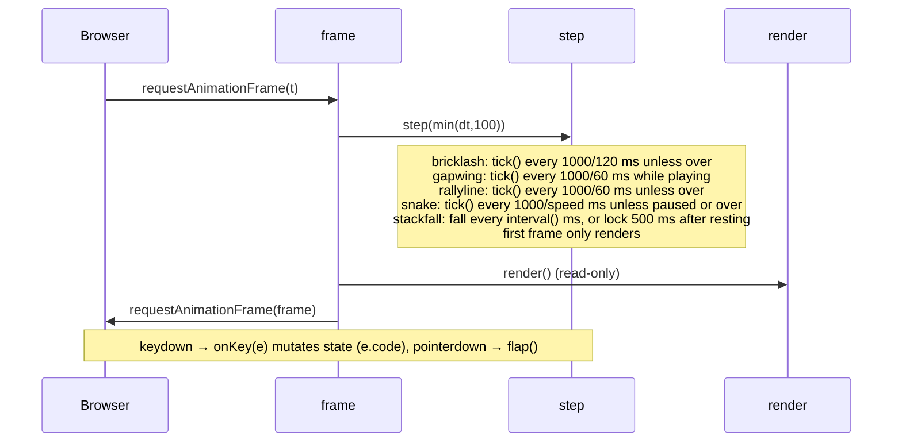
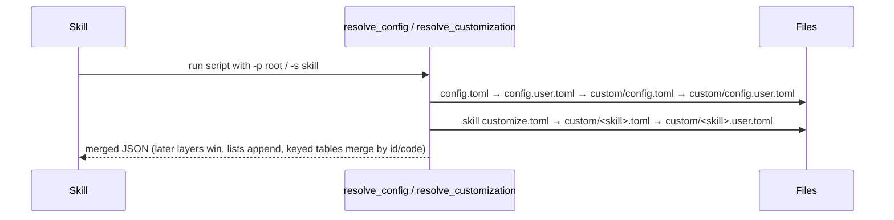

# Codebase Map

> Auto-generated by Cartographer. Last mapped: 2026-11-25T10:49:54Z

The totals count the 30 tracked project files. The vendored BMAD install (`_bmad/`, `.agents/`, `.claude/`, `.qwen/`, about 4,100 files and 10M tokens) is gitignored and not counted; only its structure is mapped here.

## System Overview

The project holds nine standalone browser games, each a single HTML file built on the same testable pattern (five canvas games with a rAF loop; Twofold, a turn-based DOM game; and Minefield, Molebop and Pairflip, DOM games whose rAF loop only drives their clocks). A shared Node harness drives it in `node:vm`, and a BMAD agent-framework install produced the specs. There is no build step and no package.json.

```mermaid
graph TB
    subgraph Games["Games (open directly in browser)"]
        Brick[bricklash.html]
        Gap[gapwing.html]
        Mine[minefield.html]
        Mole[molebop.html]
        Pair[pairflip.html]
        Rally[rallyline.html]
        Snk[snake.html]
        Stk[stackfall.html]
        Two[twofold.html]
    end
    subgraph Tests
        H[harness.mjs<br/>load: vm + stub DOM]
        TBL[test-bricklash.mjs]
        TG[test-gapwing.mjs]
        TM[test-minefield.mjs]
        TMB[test-molebop.mjs]
        TPF[test-pairflip.mjs]
        TRL[test-rallyline.mjs]
        TS[test-snake.mjs]
        TF[test-stackfall.mjs]
        TT[test-twofold.mjs]
    end
    subgraph BMAD["BMAD tooling (core, bmm, gds, cis, tea, bmb, bmad-loop)"]
        Cfg[_bmad/config.toml + custom/]
        Scripts[_bmad/scripts/*.py]
        Render[(_bmad/render cache)]
        Skills[.agents / .claude / .qwen skills<br/>identical copies]
        Adapters[.github/agents, .opencode/commands]
    end
    subgraph Output
        Specs[_bmad-output/implementation-artifacts/spec-*.md]
    end
    TBL --> H
    TG --> H
    TM --> H
    TMB --> H
    TPF --> H
    TRL --> H
    TS --> H
    TF --> H
    TT --> H
    H -->|regex-extracts script| Brick
    H -->|regex-extracts script| Gap
    H -->|regex-extracts script| Mine
    H -->|regex-extracts script| Mole
    H -->|regex-extracts script| Pair
    H -->|regex-extracts script| Rally
    H -->|regex-extracts script| Snk
    H -->|regex-extracts script| Stk
    H -->|regex-extracts script| Two
    Skills --> Scripts
    Scripts --> Cfg
    Scripts --> Render
    Adapters -->|thin pointers| Skills
    Skills -->|bmad-build-auto writes| Specs
    Specs -.documents.-> Brick
    Specs -.documents.-> Gap
    Specs -.documents.-> Mine
    Specs -.documents.-> Mole
    Specs -.documents.-> Pair
    Specs -.documents.-> Rally
    Specs -.documents.-> Snk
    Specs -.documents.-> Stk
    Specs -.documents.-> Two
```



## Directory Structure

```
retro-games/
├── bricklash.html      # Bricklash: brick-breaker, 480x640 canvas, 120 Hz fixed step, wide/multi power-ups
├── gapwing.html        # Gapwing: one-button flyer, fixed 60 Hz frames, step(dt)
├── minefield.html      # Minefield: mine-sweeping puzzle, DOM button grid, board model + shell, rAF timer
├── molebop.html        # Molebop: 30 s whack-the-mole, 3x3 DOM button holes, rAF clock, localStorage best
├── pairflip.html       # Pairflip: memory pairs, 4x4 or 6x6 DOM button cards, CSS 3D flip, rAF clock
├── rallyline.html      # Rallyline: paddle duel, 800x500 canvas, 60 Hz fixed step, AI or 2 players, first to 7
├── snake.html          # Snake: 20x20 grid, tick accumulator at `speed` ticks/s, step(dt)
├── stackfall.html      # Stackfall: 10x20 falling blocks, gravity + 500 ms lock delay in step(dt)
├── twofold.html        # Twofold: 4x4 sliding-merge puzzle, DOM tiles + CSS transitions, no step/rAF
├── harness.mjs         # load(file, globals): runs a game's <script> in node:vm with stub DOM
├── test-bricklash.mjs  # Bricklash self-check (`node test-bricklash.mjs`)
├── test-gapwing.mjs    # Gapwing self-check (`node test-gapwing.mjs`)
├── test-minefield.mjs  # Minefield self-check (`node test-minefield.mjs`)
├── test-molebop.mjs    # Molebop self-check (`node test-molebop.mjs`)
├── test-pairflip.mjs   # Pairflip self-check (`node test-pairflip.mjs`)
├── test-rallyline.mjs  # Rallyline self-check (`node test-rallyline.mjs`)
├── test-snake.mjs      # Snake self-check (`node test-snake.mjs`)
├── test-stackfall.mjs  # Stackfall self-check (`node test-stackfall.mjs`)
├── test-twofold.mjs    # Twofold self-check (`node test-twofold.mjs`)
├── docs/               # Project knowledge (BMAD project_knowledge path). This map.
├── _bmad-output/
│   └── implementation-artifacts/
│       ├── spec-bricklash-brick-breaker.md # status: done, three review passes logged, two deferred map items (resolved by this refresh)
│       ├── spec-gapwing-flappy-game.md # status: done, three review passes logged
│       ├── spec-minefield-mine-puzzle.md # status: done, three review passes logged
│       ├── spec-molebop-whack-game.md    # status: done, three review passes logged, end-lock change log
│       ├── spec-pairflip-memory-game.md  # status: done, three review passes logged, two deferred items
│       ├── spec-rallyline-paddle-duel.md # status: in-progress, no review passes yet
│       ├── spec-snake-game.md          # status: done, three review passes logged
│       ├── spec-stackfall-puzzle.md    # status: done, three review passes logged
│       └── spec-twofold-merge-puzzle.md # status: done, three review passes logged
├── _bmad/              # BMAD v6.12.4 install: core, bmm, gds 0.7.2, cis 0.3.2, tea 1.27.2, bmb 2.2.2, bmad-loop 0.13.2
│   ├── config.toml, config.user.toml   # installer-managed. Do not edit.
│   ├── custom/                         # SAFE to edit: team/personal overrides
│   ├── scripts/                        # config resolution, renderer, memlog
│   ├── render/                         # generated render cache (gitignored, empty now)
│   ├── _config/                        # installer manifests and help CSVs
│   └── bmm/, core/, gds/, cis/, tea/, bmb/, bmad-loop/  # per-module config.yaml + module-help.csv
├── .agents/skills/     # 90 skills (opencode target; .github agents point here)
├── .claude/skills/     # same 90 skills (claude-code target)
├── .qwen/skills/       # same 90 skills (qwen target)
├── .github/agents/     # 18 Copilot agent pointers -> .agents/skills
└── .opencode/commands/ # OpenCode command pointers (@skills/<name>)
```

## Module Guide

### bricklash.html

**Purpose**: Original brick-breaker on a 480×640 canvas: a 6x10 wall (one color per row, top row 60 points down to 10), paddle by mouse/touch or arrows, 3 lives, levels with a faster ball, and wide-paddle / multi-ball capsules. Canvas shapes only.
**Entry point**: open the file in a browser. The script ends with `reset(); requestAnimationFrame(frame);`.

| Item | Detail |
|---|---|
| Constants | `W=480`, `H=640`, `HUD=40` (ceiling), `TICK=1000/120`, `HZ=120`, bricks `COLS=10`×`ROWS=6` of `BW=48`×`BH=20` from `TOP=80`, `PADDLE_Y=600`, `PADDLE_H=12`, `PADDLE_W=80`, `WIDE_W=120`, `PADDLE_SPEED=480` px/s, `BALL_R=6`, `SERVE_ANGLE=π/6`, `MAX_BOUNCE=π/3`, `MULTI_ANGLE=π/4`, `CAP_W/CAP_H=24/10`, `CAP_SPEED=150` px/s, `DROP_P=0.125`, `WIDE_TICKS=1200` (10 s), `COLORS` per row, top row first |
| State | Top-level `let`s: `state` (`serve`/`playing`/`over`), `score`, `lives`, `level`, `bricks` (60 booleans, index `r*10+c`), `balls` (`{x,y,vx,vy}[]`, px/s; `px`/`py`, the previous centre, are set at the start of each ball's step in `tick()`), `capsules` (`{x,y,type}[]`), `paddleX` (left edge), `paddleW`, `wide` (ticks left), `acc`, `last` (previous frame time, `null` until the first frame); `keyL`/`keyR` (held arrows: `reset()` leaves them, so a hold survives a restart, but the top-level `onblur` clears them). Ball speed `speed()` = `min(720, 360 + 40·(level-1))`. |
| Logic | `tick()`: `movePaddle()`; in serve the ball rests on the paddle centre and nothing else runs; otherwise each ball moves `v/120`, then `walls()`, `paddleHit()` (needs `vy > 0`, the previous bottom `py+BALL_R <= PADDLE_Y` so a paddle slid under a low ball can't scoop it, the ball inside the paddle's y band, and x overlap within `BALL_R`; then angle `60°·clamp(offset/halfWidth)` from vertical at the same speed, ball not repositioned), `brickHit()` (first overlapping cell in index order, one per ball per tick, `(6-row)*10` points; by the previous centre, outside the cell's columns sets `vx` away with `Math.abs`, inside them sets `vy` away by which half it came from, and a corner does both, so a ball already leaving is never turned back; then `random() < 0.125` drops a capsule at the cell centre and `random() < 0.5` picks wide or multi). Then balls whose top passed 640 are dropped; with none left `loseLife()` runs and the tick ends. Otherwise the wide timer counts down before catches (a catch this tick keeps the full 1200 ticks), capsules fall 1.25 px and are caught when their 24×10 box overlaps the paddle rectangle (edges inclusive), and an empty wall calls `nextLevel()`. Multi adds two balls at `balls[0]`, ±45° up, at `speed()`, no cap. `serve()` sets `serve`, clears capsules and `wide`, restores the 80 px paddle about its centre and makes one resting ball; `loseLife()` on the last life clears the same power-ups. `launch()` resets from over, ignores any state but serve, re-seats the ball on the paddle, then fires 30° right of vertical at `speed()`. Helpers: `clamp`, `setWidth(w)` (resize about the centre, clamped to the walls), `restBall(b)`. |
| Render | `render()` only reads state: HUD band with `Score N` / `Lives N` / `Level N`, bricks inset 1 px (collision uses the full cell), capsules labelled W / M, paddle (amber while wide), balls, serve title and game-over overlay. `setText()` updates `#status` (`aria-live`, written only on change): `Level N, M lives.` (`1 life` for one) `Press Space or click to launch.`, `Playing.`, or `Game Over. Score: N. Press Space or click to play again.` |
| Loop | `frame(t)`: the first frame only renders; later frames call `step(min(dt,100))` then `render()`. `step` returns while over and its tick loop stops as soon as a tick ends the game. |
| Input | `keydown` → `onKey` (`String(e.code)`; `preventDefault` on Space and every `Arrow*` code, repeats included; ArrowLeft/Right set `keyL`/`keyR`, a non-repeat Space calls `launch()`), `keyup` clears them; `pointermove` (hover too, no button needed) centres the paddle on the pointer scaled by the canvas `getBoundingClientRect()` (border included, so up to 2 px off); `pointerdown` with `button === 0` calls `launch()`. These four are on `document`. Window blur is a bare top-level `onblur = () => { keyL = keyR = false; }` (a held arrow's keyup never arrives after focus loss; a bare global because the harness has no `window`). `touch-action: none` and `user-select: none` are on `body`, so a drag anywhere steers instead of panning; the canvas has `box-sizing: border-box`, `max-width: 100%`, `max-height: 80vh`. `#hint`: "Mouse, touch or ← → : move · Space / click / tap: launch". |
| Persistence | None (by spec). |

### gapwing.html

**Purpose**: Original one-button flyer on a 400×600 canvas: flap a circle bird through gaps between scrolling pillars. Art is canvas shapes only, with parallax hills, clouds and ground.
**Entry point**: open the file in a browser. The bottom of the script calls `reset()` and then starts `requestAnimationFrame(frame)`.

| Item | Detail |
|---|---|
| Constants | `W=400`, `H=600`, `GROUND=540`, `FRAME=1000/60`, `GRAVITY=0.5`, `FLAP_VY=-8`, `SPEED=2` (per frame), `BIRD_X=100`, `BIRD_R=12`, `START_Y=260`, `PIPE_W=60`, `SPAWN_EVERY=90` frames, `MARGIN=60`, `GAP0=150`, `GAP_MIN=100`, `RESTART_MS=500` |
| State | Top-level `let`s: `state` (`ready`/`playing`/`over`), `y`, `vy`, `pipes` (`{x,top,gap,scored}[]`), `score`, `acc`, `spawnT`, `overTime`, `dist` (px scrolled, drives parallax) |
| Logic | `reset()`, `gapFor(score)`, `spawnPipe()`, `hits(p)` (circle vs pillar column; the top pillar extends upward without limit), `die()`, `tick()` (one 60 Hz frame: move, cull, spawn, score, then death check), `step(dt)` (frame accumulator; stops after a death mid-step; only counts `overTime` while over), `flap()`, `onKey(e)` |
| Render | `render()` only reads state. `layer()` tiles a scrolled layer: far hills at `dist*0.2`, clouds and near hills at `dist*0.5`, ground ticks at `dist`. Score, ready title and hint, and game-over text are drawn on the canvas; the restart hint appears only after 500 ms. `setText()` updates `#status`. |
| Loop | `frame(t)`: `step(min(dt,100))` then `render()` |
| Input | Space keydown (`preventDefault` even on repeat; repeat does not flap) and `pointerdown` on `document` with `e.button === 0` (left click, touch, pen), both call `flap()`. Ready → playing on the first flap. Over: input is ignored for 500 ms, then `reset()` returns to ready. |
| Scoring | +1 when a pillar's right edge passes the bird's centre (checked before the death check, so the fatal tick can still score). Gap = `max(100, 150 - 5·floor(score/5))`, fixed per pillar at spawn. |
| Persistence | None (by spec) |
| A11y | Canvas has `role="img"` and an `aria-label`. `#status` is `aria-live="polite"` and changes only with the state. |
| Layout | Canvas `width="400" height="600"`, CSS `max-width:100%`, `max-height:80vh`. `body` uses `min-height:100vh` so short viewports scroll instead of clipping; `touch-action: manipulation`. |

### minefield.html

**Purpose**: Mine-sweeping puzzle in three sizes. DOM-based: the board is a CSS grid of `<button class="cell">`s, one per cell index, with its column count set by the board's difficulty class (`--cols`). Own name, no face on the reset button, sea-green/sand/amber palette.
**Entry point**: open the file in a browser. The script ends with `reset(); render(); requestAnimationFrame(frame);`.

| Item | Detail |
|---|---|
| Constants | `LEVELS` (`easy` [9,9,10], `medium` [16,16,40], `hard` [30,16,99] as width, height, mines), `LONG_PRESS=450` ms, `SLOP=10` px |
| Board model | Plain functions over a plain object, no DOM. `newBoard(w,h,mines)` → `{w,h,mines,placed,boom,left,cells}`; `cells` is flat (`y*w+x`) of `{mine,count,open,mark}` with `mark` `''`/`'flag'`/`'question'`; `boom` is the index of the mine that went off (-1 if none); `left` counts hidden safe cells. `neighbours(b,i)`, `status(b)` (`ready` until placed, `lost` if `boom >= 0`, `won` when `left` is 0, else `playing`), `placeMines(b,safe,rand)` (partial Fisher–Yates over cells outside the safe cell's 3x3, then counts), `openCell(b,i)` (internal: opens a mine → `boom`, else a breadth-first queue with an index pointer; only flags stop it, question marks are cleared; flags every mine on the win), `reveal(b,i)` (refuses marked cells), `cycleMark(b,i)`, `chord(b,i)` (opens every unflagged neighbour of a revealed number whose adjacent flags equal it; question-marked neighbours open too; already-open ones are skipped, so `left` stays exact). `cycleMark` works before the first reveal; flags stop a flood, question marks only block a direct click. Model functions mutate the board. |
| State | Top-level `let`s: `level`, `board`, `elapsed` (ms counted while playing, capped at 999000), `press` (`{id,x,y,i,held}` of a touch that may become a long press), `suppress` (swallow the click after a long press), `fired` (this touch's long press already marked, so a late `contextmenu` must not mark again), `slipped` (the touch moved past `SLOP`), `ctxSeen` (a `contextmenu` came since the last pointerdown, so a pointer Ctrl+click is a Mac right click), `pointerDown`, `cellEls` (button per cell index), `last` (previous rAF time) |
| Shell | `reset()` (new board at `level`, timer 0, drops `press`; doesn't render), `open(i)` (ignored after an end; chord on a revealed cell, else places mines on the first reveal and calls `reveal`), `mark(i)`, `firePress()` (marks the pressed cell and sets `suppress` and `fired`), `step(dt)` (counts `elapsed` while playing, ages `press` and fires it at 450 ms), `onKey(e)` (any key clears `slipped`, and clears `suppress`/`fired` only when no pointer is down; then N new game, F marks the focused cell; repeats and Ctrl/Meta/Alt ignored; no `preventDefault`) |
| Render | `render()` reads state and writes only the DOM: rebuilds `cellEls` when the cell count or the level changes (so New game reuses the buttons), sets the board's class and `aria-label`, then per cell writes `className`, text and `aria-label` only when they change. `look()` picks open number/empty, lost-state mine/`boom`/`wrong`, flag, question or hidden. `setText()` for `#mines`, `#time`, `#status` ("You cleared the field in N second(s)." / "A mine went off. Press New game to try again."); `aria-pressed` on the difficulty buttons, written only on change. |
| Loop | `frame(t)`: `step(min(dt,100))` (the first frame doesn't step), then `render()` only when the shown whole second changed; input handlers and a fired long press render themselves |
| Input | `click` on `document`: a pointer Ctrl+click after a `contextmenu` (Mac) is ignored, keyboard clicks (`detail` 0) never are; a long press's `suppress` swallows one pointer click; a cell (found by `cellEls.indexOf(target)`) → `open`; `#new` → reset; `#easy`/`#medium`/`#hard` (`Object.hasOwn(LEVELS, id)`) → switch level and reset. `pointerdown`: sets `pointerDown`, clears `suppress`, `slipped`, `ctxSeen` and `fired`, and starts `press` only for a primary button-0 touch on a hidden cell in a live game. `pointermove` > 10 px with the same id drops `press` and sets `slipped`. `pointerup`/`pointercancel` clear `pointerDown` and drop `press` if the id matches. `contextmenu` (right click, Mac Ctrl+click, the ContextMenu key, Shift+F10, a touch long press) sets `ctxSeen`; inside `#board` it is prevented, then skipped if `fired` or `slipped`, fires a pending `press` early, or else marks the target cell. Enter and Space reveal the focused cell through the native button click. |
| Persistence | None |
| A11y | `#board` `role="grid"` with an `aria-label` naming the size and mine count; each cell button has `aria-label` `Row r, column c, <state>`; `#status` `aria-live="polite"` written only on change (win with seconds, loss). |
| Layout | `#board` `width: max-content` inside `.wrap` with `overflow-x: auto`, so Medium and Hard scroll sideways on a portrait phone; cell size `clamp(24px, …, 34px)`; `touch-action: manipulation` and `-webkit-touch-callout: none` on the board. |

### molebop.html

**Purpose**: Original 30-second whack-the-mole game on a 3x3 field of `<button class="hole">`s, each with one `.mole` span that slides up by CSS transform. A golden mole (★) scores 5, a bomb (✸) ends the round, an empty hole costs 1 (never below 0). DOM-only, no canvas, audio or assets; grass-green/earth palette.
**Entry point**: open the file in a browser. The script ends with `reset(); render(); requestAnimationFrame(frame);`.

| Item | Detail |
|---|---|
| Constants | `ROUND=30000`, `FIRST_POP=500`, `POP_EVERY=800`, `POP_FAST=450`, `FAST_AT=10000`, `LOCK=500` (ms); `BEST_KEY='molebop-best'`; `NAMES`/`GLYPH` (kind → label / glyph: mole `''`, golden `★`, bomb `✸`); `NUMPAD=[6,7,8,3,4,5,0,1,2]` (Numpad1..9 → hole, so Numpad7 is top-left) |
| State | Top-level `let`s: `phase` (`ready`/`playing`/`over`), `reason` (`''`/`time`/`bomb`), `score`, `timeLeft`, `popIn` (ms to next pop), `holes` (9 × `null` or `{kind, up}` with `up` = ms left above ground), `lock` (ms before Start works again after an end), `best`, `last` (previous rAF time). `holeEls`/`moleEls` hold the nine buttons and spans, built once. |
| Logic | `reset()` (ready state, `lock` 0; doesn't render), `start()` (refused while `lock > 0`; else reset, playing, render), `end(why)` (over, `lock = LOCK`, clears holes, saves a beaten best in try/catch), `pop()` (random empty hole; kind: r<0.1 golden, r<0.2 bomb, else mole; `up = 700 + rand·500`; no-op on a full field), `step(dt)` (while over only counts `lock` down; while playing clamps `timeLeft` at 0 and ends on 0, ages holes, then pops and adds 450 or 800 ms to `popIn` by the time left at that pop), `whack(i)` (ignored unless playing; empty → −1 floor 0; hit clears the hole and scores 1/5; bomb → `end('bomb')`; renders) |
| Render | `render()` reads state, writes only changed DOM: `setText` for `#score`, `#time` (`ceil(timeLeft/1000)`), `#best`, `#message`, `#status`; per hole the class (`hole` / `hole up`) and `aria-label` (`Hole N, <name or empty>`); mole span class and glyph only while the hole is up; `#panel.hidden` (hidden while playing) and `#field.inert` (inert unless playing). |
| Loop | `frame(t)`: `step(min(dt,100))` (first frame doesn't step; a `shortcut:` comment notes that frames over 100 ms run slow), then `render()` only if `shown()` (phase + shown second + hole kinds) changed; score changes render from input |
| Input | `keydown` → `onKey`: Space/Enter/NumpadEnter are start keys (a repeat is `preventDefault`ed so a held key can't click a focused hole again and again); other repeats and any Ctrl/Meta/Alt/Shift return; a start key while not playing is prevented and calls `start()`; `Digit1-9` whack in reading order, `Numpad1-9` via `NUMPAD`. `pointerdown` with `button 0` on a hole (`holeEls.indexOf(target)`) whacks on press. `click`: `#start` while not playing → `start()`; a hole click with `detail 0` (Enter/Space on a focused hole) whacks; pointer clicks (`detail ≥ 1`) are skipped since `pointerdown` already whacked. |
| Persistence | `localStorage['molebop-best']`, read at load (`Number(...) || 0`) and written in `end()` when beaten; every access in try/catch. Nothing else is saved. |
| A11y | `#field` `role="group"` with `aria-label`; each hole button `aria-label` `Hole N, <state>`; golden and bomb differ by glyph, not only colour; `#status` `aria-live="polite"`, written only when over; `#field.inert` outside a round keeps dead holes out of the Tab order. |
| Layout | `#game-container` `min(420px, 94vw)`; header `flex-wrap: wrap` so Best drops to a second row on a 360 px phone; holes `aspect-ratio: 1`; `#field` `touch-action: manipulation`; needs a browser from about 2023 (`inert` reached Firefox in 112). |

### pairflip.html

**Purpose**: Original memory-pairs game. Normal is a 4x4 board (8 pairs, letters A-H), Hard is 6x6 (18 pairs, A-R). Each card is a `<button class="card">` that turns over with a CSS 3D flip. Moves and an m:ss timer sit in the header; a win panel covers the board. DOM-only: no canvas, audio, assets, emoji or storage.
**Entry point**: open the file in a browser. The script ends with `reset(); render(); requestAnimationFrame(frame);`.

| Item | Detail |
|---|---|
| Constants | `MODES={normal:4, hard:6}` (cards per side; pairs = `MODES[mode]**2/2`, faces `String.fromCharCode(65+i)`), `FLIP_BACK=800` (ms a mismatched pair stays face-up) |
| State | Top-level `let`s: `mode`, `cards` (`[{face, up, matched}]`), `open` (indices of face-up unmatched cards, 0-2), `moves`, `elapsed` (ms), `hold` (ms before a mismatch flips back, 0 = none), `note` (last flip, for `#status`), `cardEls` (one button per card index, rebuilt only when the card count changes), `last` (previous rAF time). Helpers `won()` and `started()` (`moves > 0` or a card open). |
| Logic | `shuffle(a, rand)` (in-place Fisher-Yates; `rand` injectable). `reset()` deals the doubled faces through `shuffle(…, Math.random)`, all face-down, zeroes `moves`/`elapsed`/`hold`, clears `note`; doesn't render. `flip(i)` is ignored if won, the card is up (matched cards stay up) or two are open; on the second card `moves++`, `note` = `A and B, matched` / `no match`, a match marks both and empties `open`, a mismatch sets `hold = FLIP_BACK`; renders, then focuses `#again` if the flip won. `step(dt)` adds to `elapsed` while `started() && !won()` and counts `hold` down, turning the open pair face-down at 0. `restart()` remembers whether `#again` had focus, resets, renders, and then focuses the first card only in that case. |
| Render | `render()` reads state and writes only changed DOM via `setText`/`setAttr`. On a card-count change it rebuilds `cardEls` and sets `#board` class (mode) and `aria-label` (`Cards, N by N`). Per card: `className` (`card` / `card up` / `card up matched`), `data-face` only while `c.up`, `aria-label` `Row r, column c, <face down / X / X, matched>`, `tabindex` `-1` when matched else `0`. Then `aria-pressed` on the mode buttons, `#moves`, `#time` (`clock(ms)` → m:ss), `#result`, `#status` (win message, else `note`), and `#win.hidden` / `#board.inert` from `won()`. |
| Loop | `frame(t)`: `step(min(dt,100))` (first frame doesn't step), then `render()` only if the shown second or `open.length` changed; clicks and keys render themselves. |
| Input | `keydown` → `onKey`: a repeated Space/Enter/NumpadEnter is `preventDefault`ed (a held key must not re-click the freshly focused `#again`); other repeats and Ctrl/Meta/Alt return; `KeyR` → `restart()`. One `click` listener on `document`: a card (`cardEls.indexOf(target)`) → `flip`; `#restart`/`#again` → `restart()`; a mode button (`MODES[target.id]`) → set `mode`, reset, render, `target.focus()` (Safari doesn't focus a clicked button, and the focused card may be gone). No pointer events, no timers. |
| Persistence | None (the test bans `localStorage`). |
| A11y | `#board` `role="group"` with a size label; per-card labels as above; matched cards leave the Tab order; on a win the board goes `inert` and `#again` takes focus; `#status` `aria-live="polite"` announces each flip and the win, written only when it changes. |
| 3D flip CSS | `.card` `transform-style: preserve-3d`, `perspective(500px) rotateY(0deg)`, `transition: transform 0.3s`; `.card.up` `rotateY(180deg)`. Back = `::before` (violet stripes), front = `::after` with `content: attr(data-face)` and its own `rotateY(180deg)`; both `backface-visibility: hidden`. `.card.matched::after` turns mint. Hover ring inside `@media (hover: hover)`; amber `:focus-visible` outline; `prefers-reduced-motion` drops the transition. |
| Layout | `#board` grid with `--size: min(calc((96vw - 24px) / var(--cols) - 8px), var(--max))`; `.normal` 4 cols / 84 px max, `.hard` 6 cols / 60 px max. `#win` is an absolute `inset: 0` overlay inside `.stage`, with `#win[hidden] { display: none }`. Needs about 2021 (`?.`, `min()`, `inset`); `inert` and `:focus-visible` degrade gracefully. |

### rallyline.html

**Purpose**: Original paddle-and-ball duel on an 800×500 canvas: left paddle on W/S, right paddle an AI (or a second player on the arrows), first to 7. Canvas shapes only, teal and amber paddles, a square ball.
**Entry point**: open the file in a browser. The script ends with `reset(); requestAnimationFrame(frame);`.

| Item | Detail |
|---|---|
| Constants | `W=800`, `H=500`, `TICK=1000/60`, paddles `PW=12`×`PH=80` at `LX=20` / `RX=W-LX-PW` (768), `PADDLE_SPEED=6` px/tick, ball half-size `HALF=5` (10x10 square), `SERVE_SPEED=5`, `SPEED_UP=1.05`, `MAX_BOUNCE=π/3`, `WIN=7`, `DEG` |
| State | Top-level `let`s: `state` (`serve`/`playing`/`over`), `scoreL`, `scoreR`, `leftY`/`rightY` (paddle tops), `ball` (`{x,y,vx,vy}`, px/tick, centre), `speed`, `acc`, `last`; `twoPlayer` and `aiSpeed` (page controls, untouched by `reset()`); `held` (a `Set` of held W/S/arrow codes: `reset()` leaves it, `onblur` clears it). |
| Logic | `tick()`: `movePaddles()` (W/S; the right paddle is the arrows in 2-player mode, else the AI moves its centre toward `ball.y` by at most `aiSpeed`; both clamped to 0..420); in serve nothing else runs. Otherwise the ball moves, then `paddleHit()` for each side: the ball must move toward the paddle, its leading edge must cross the front face this tick (previous edge on the near side, new edge at or past it, so fast balls can't tunnel) and its y span at the crossing point (interpolated from the previous y, mirrored off the top or bottom wall if the ball bounced first) must overlap the paddle; then `speed *= 1.05`, angle `60°·clamp(offset/(PH/2+HALF))` from horizontal, ball placed flush at the crossing point. Then the top/bottom walls set `vy` away with `Math.abs`. `step()` snaps `acc` to `TICK` when within 0.5 ms, so rAF jitter on a 60 Hz display runs one tick per frame. A ball fully past an edge calls `point()`: +1 to the other side, `over` at 7, else `toServe()` (ball at centre, still, speed 5; paddles stay). `launch()` resets from over, ignores playing, and serves at angle `random()*60-30` degrees, right if a second `random() < 0.5`. |
| Render | `render()` only reads state: court, dashed centre line, both scores in bold 56 px either side of it, paddles, ball, "Space to serve" or the over overlay (`winner()`: `You win`/`AI wins`, or `Left wins`/`Right wins` in 2-player mode, plus "Space to play again"). `setText()` updates `#status`: `Score L-R. Press Space to serve.`, `Playing.`, or `<winner> L-R. Press Space to play again.` |
| Loop | `frame(t)`: the first frame only renders; later frames call `step(min(dt,100))` then `render()`. `step` returns while over. |
| Input | `keydown` → `onKey` (`String(e.code)`): Space is always `preventDefault`ed, ArrowUp/Down only in 2-player mode (so the focused range keeps its arrows in 1-player mode); W/S/arrows go into `held`; a non-repeat Space on the focused `#two` toggles it and calls `readControls()` (the prevented keydown stops the native toggle), otherwise `launch()`. `keyup` → `onKeyUp` deletes from `held` and also prevents Space (some browsers toggle a checkbox on keyup). One `input` listener → `onInput`: `readControls()` copies `#two.checked` and `#ai.value` into `twoPlayer`/`aiSpeed` and disables `#ai` in 2-player mode, then blurs `#two` when it was the target, so Space serves next. Window blur is a bare `onblur`, as in Bricklash. No pointer or touch paddle control. |
| Persistence | None. The inputs carry `autocomplete="off"`, so a reload can't restore a checkbox state the script never read. |
| Layout | Canvas `width="800" height="500"`, CSS `max-width:100%`, `max-height:80vh`; `#controls` (checkbox and range) and `#hint` under `#status`. |

### snake.html

**Purpose**: Classic snake on a 400×400 canvas (20×20 cells of 20 px). No ready screen: the run starts moving right on load.
**Entry point**: open the file in a browser. The script ends with `reset(); requestAnimationFrame(frame);`.

| Item | Detail |
|---|---|
| Constants | `N=20`, `CELL=20`, `W=400`, `START_SPEED=8` ticks/s, `SPEED_UP=0.5`, `HS_KEY='snakeHighScore'`, `DIRS` (Arrow and WASD codes → `[dx,dy]`) |
| State | Top-level `let`s: `snake` (`{x,y}[]`, head first), `dir` (last moved), `nextDir` (queued), `food` (`{x,y}` or `null` on a full board), `score`, `speed`, `acc`, `over`, `won`, `paused`, `wrap` (not touched by `reset()`), `high` (read from `localStorage` at load) |
| Logic | `reset()`, `onSnake(x,y,cells)`, `placeFood()` (uniform pick over empty cells; none left → `end(true)`), `end(win)` (re-reads the stored high first so another tab's record survives, sets `over`/`won`, writes a beaten high score), `tick()` (one move: wrap or wall, body check against `snake.slice(0, -1)` so the vacating tail is always free (an eating head is never on the snake, since food only spawns on empty cells), grow, +10, +0.5 speed at each multiple of 50, no cap), `step(dt)` (accumulator, `1000/speed` ms per tick; nothing while over or paused; stops after a death mid-step), `onKey(e)` |
| Render | `render()` only reads state: checkerboard, food, snake, `Score:`/`High:` (live best, `Math.max(high, score)`; `Wrap` only when on) on the canvas in row 0, then a `Paused` or `Game over`/`You win!` + score + `Press Space to restart` overlay. `setText()` updates `#status`. |
| Loop | `frame(t)`: `step(min(dt,100))` then `render()` |
| Input | keydown only. Arrows and Space get `preventDefault` (always, even while over). While over only Space acts (`reset()`). Otherwise P toggles pause, T toggles wrap (both ignore repeat), and a direction key sets `nextDir` unless it reverses `dir`, so two keys in one tick can't reverse the snake (the last valid key wins; steering and T still work while paused). Lookup is `Object.hasOwn(DIRS, e.code)`, and `String(e.code)` guards events with no `code`. |
| Persistence | `localStorage['snakeHighScore']`, read at load and re-read in `end()`; every access is in try/catch, so blocked or missing storage gives high 0 (the in-memory best still updates). |
| A11y | Canvas `role="img"` with `aria-label`; `#status` is `aria-live="polite"` and changes only with the state (playing + wrap, paused, over/win). |
| Layout | Canvas `width="400" height="400"`, CSS `max-width:100%`, `max-height:80vh`; `body` `min-height:100vh`. Keyboard only: no pointer or touch handlers and no `touch-action`. |

### stackfall.html

**Purpose**: Original falling-blocks puzzle on a 450×600 canvas: a 10×20 board of 30 px cells plus a 150 px side panel (next, hold, score, lines, level). Own name and seven-colour palette.
**Entry point**: open the file in a browser. The script ends with `reset(); requestAnimationFrame(frame);`.

| Item | Detail |
|---|---|
| Constants | `COLS=10`, `ROWS=20`, `CELL=30`, `BW=300`, `H=600`, `W=450`, `LOCK_MS=500`, `SHAPES` (I, O, T, S, Z, J, L as square 0/1 matrices), `KEYS`, `COLORS` (I `#e07a5f`, O `#81b29a`, T `#f2cc8f`, S `#6d9dc5`, Z `#b388eb`, J `#ef6f9f`, L `#4c5ae6`), `POINTS=[0,100,300,500,800]` |
| State | Top-level `let`s: `board` (20 rows of 10; `''` empty, else the shape key), `piece` (`{k,m,x,y}`), `bag`, `nextK`, `holdK` (`null` until first hold), `canHold`, `score`, `lines`, `dropAcc`, `lockTimer`, `over`. Level is derived: `level()` = 1 + floor(lines/10), `interval()` = max(50, round(1000·0.8^(level-1))) ms. |
| Logic | `reset()`, `take()` (7-bag, Fisher–Yates on `Math.random`), `spawn(k)` (x = floor((10 - box)/2), y 0, zeroes `dropAcc` and `lockTimer`; collision → `over`), `spawnNext()`, `fits(m,x,y)`, `tryMove(dx,dy)` (a move down resets `lockTimer`; sideways moves don't), `rotate()` (clockwise in its box, kicks 0, -1, +1, never up; does not touch the timers), `ghostY()`, `lock()` (write cells, drop full rows, score × level before the clear, re-enable hold, spawn next), `hold()` (first hold takes `nextK` and one bag piece; a swap uses `spawn(holdK)` and leaves the bag alone; a blocked respawn ends the game), `step(dt)` (falls every `interval()` while it can and zeroes `dropAcc` on landing; when resting, zeroes `dropAcc`, `lockTimer += dt`, lock at 500; air time neither counts nor resets the lock timer), `onKey(e)` |
| Render | `render()` only reads state: well and grid, locked cells, ghost outline (`strokeRect`, hidden while over), piece, the side panel (`Next`, `Hold` greyed while used, `Score:`/`Lines:`/`Level:`), then a `Game over` + score + `Press R to restart` overlay. `setText()` updates `#status`. |
| Loop | `frame(t)`: `step(min(dt,100))` then `render()` |
| Input | keydown only. Arrows and Space get `preventDefault` (always, even while over). While over only R acts (`reset()`). ←/→/↓ accept key repeat; ↑ rotate, Space hard drop and C/Shift hold ignore it. A successful soft drop zeroes `dropAcc`; drops score nothing. `String(e.code)` guards events with no `code`; modifier keys are not filtered. |
| Persistence | None (by spec) |
| A11y | Canvas `role="img"` with `aria-label`; `#status` is `aria-live="polite"` and reads `Level N.` or `Game over. Score: N. Press R to restart.`, written only when the text changes. |
| Layout | Canvas `width="450" height="600"`, CSS `box-sizing:border-box` (so the 2 px border stays inside `max-width:100%`), `max-height:80vh`; `body` `min-height:100vh`. Keyboard only: no pointer or touch handlers. |

### twofold.html

**Purpose**: Original sliding-merge number puzzle on a 4×4 board. DOM-based: the board is a CSS grid of 16 static `.cell`s with absolutely positioned `.tile` elements that slide via `transition: transform`. Own name and teal→violet→coral→gold palette.
**Entry point**: open the file in a browser. The script ends with `reset(); render();`. There is no `step(dt)` and no rAF loop: `move()`, `undo()` and the button/key handlers call `render()` directly.

| Item | Detail |
|---|---|
| Constants | `SIZE=4`, `GOAL=2048`, `SWIPE=30` px, `BEST_KEY='twofoldBest'`, `DIRS` (`left/right/up/down`), `KEYS` (Arrow codes → dir), `CONTINUE_KEYS` (`Enter`, `NumpadEnter`, `KeyC`) |
| Pure rules | No DOM or globals; inputs never mutated. `emptyBoard()`, `lines(dir)` (cells of each line ordered from the edge tiles slide toward), `track(board, dir)` → `{board, gained, moved, moves}` (compress, then merge equal neighbours with a skip after each merge), `slide(board, dir)` → `{board, gained, moved}`, `addTile(board, rand)` (first `rand()` picks a uniform empty cell, second gives 2 if < 0.9 else 4; full board → unchanged copy), `canMove(board)`, `hasTile(board, value)` |
| State | Top-level `let`s: `board` (4×4 numbers, 0 empty), `score`, `best`, `won`, `keepPlaying`, `over`, `prev` (`{board, score, ids, won, keepPlaying}` or `null`), `undone`, `ids` (tile id per cell), `ghosts` (tiles merged away last move), `nextId` (never reset, so a new game never reuses an element), `swipeFrom` (`{id, x, y}` of the pointer that started a swipe, or `null`) |
| Shell | `reset()` (empty board + two `addTile`, clears flags and `prev`), `move(dir)` (ignored while over or on the win message; no-op if nothing moved; else saves `prev`, carries ids via `track().moves`, spawns, scores, saves best, sets `won` on the first 2048 and `over` when `!canMove`, renders, then focuses `#continue` on the first 2048), `keepGoing()` (sets `keepPlaying`), `undo()` (restores `prev` once, including `won` and `keepPlaying`, so undoing past a Continue shows the 2048 message again; clears `over`), `onKey(e)`. `reset()` does not render; callers follow it with `render()`. |
| Render | `render()` reads game state and writes only the DOM: one element per tile id in an `els` Map (created on first sight, removed when gone), class `tile v<value or big> d<digits>`, `transform: translate(calc(c * (100% + var(--gap))), …)`. Merged-away tiles stay one move as `.gone` under their partner. `setText()` updates `#score`, `#best`, `#message-text`, `#status`; `#message`/`#continue` toggle `hidden`, `#undo` `disabled`. It reads `document.activeElement` first and, if that control ends up hidden or disabled, focuses `#new` (Chrome drops focus to body as soon as a focused control is hidden). The win message wins over game over when both happen in one move. |
| Input | keydown: arrows `preventDefault` + move (repeat moves again), N new game, U undo; while the win message is up, Enter, numpad Enter or C continue (with `preventDefault`, so the keypress can't click the newly focused button). Other keys untouched; modifiers are not filtered. Any handled key clears a pending swipe. Swipe on `document`: `pointerdown` from a primary pointer records `{id, x, y}` only for button 0 inside `.wrap` and not on a button (any other primary press clears it; a second finger is ignored); `pointercancel` with the same id clears it; `pointerup` with the same id moves if the drag length (`Math.hypot`) is ≥ 30 px, along the larger component, ties vertical. `click` on `document` delegates by `e.target.id` (`new`, `undo`, `continue`, the last with the same guard as the keys), since harness stub elements have no `addEventListener`. |
| Persistence | `localStorage['twofoldBest']`, read at load, written whenever score beats it; every access in try/catch. Undo never lowers best. The game in progress is not saved. |
| A11y | `#board` `role="grid"` with `aria-label`; `#status` `aria-live="polite"` written only on change: win, game over, `Move undone.`, else empty. `prefers-reduced-motion` drops the transitions. |
| Layout | `#game-container` `min(400px, 92vw)`; board `aspect-ratio: 1`; the 16 tile uses dark text for contrast; needs a browser from about 2022 (`scale` in keyframes, `aspect-ratio`, `Object.hasOwn`); `.wrap` `touch-action: none` so swipes on the board don't scroll; `body` `min-height:100vh`. |

### harness.mjs, test-bricklash.mjs, test-gapwing.mjs, test-minefield.mjs, test-molebop.mjs, test-pairflip.mjs, test-rallyline.mjs, test-snake.mjs, test-stackfall.mjs, test-twofold.mjs

**harness.mjs** exports `load(file, globals = {})`. It:
- regex-extracts the single bare `<script>`;
- runs it in `node:vm` with a stub `document.getElementById` (which returns `{getContext, textContent}`), a captured `document.addEventListener` and a no-op `requestAnimationFrame`;
- uses a Proxy `ctx2d` that records `fillText` calls into `texts`. Extra globals, such as a `localStorage` stub, are passed through `globals`.

`load` returns:
- `run(code)`: evaluates code inside the vm. This is the only way to reach top-level `let`s.
- `key(code, repeat=false)`
- `listeners`
- `texts`

**test-bricklash.mjs** covers each row of the Bricklash spec's I/O matrix and the three review passes: markup (canvas 480x640, one script, no named-game branding), the opening serve (60 bricks, ball on the paddle, HUD text), serve follow and keyup, launch angle and speed with repeat and right-click ignored, launch re-seating the ball after a pointer move, paddle bounce at centre and both edges (normal and wide), no bounce while rising or once the previous bottom was below the paddle top, the 1 px reach cutoff, misses past either side, paddle clamp by keys and pointer (half-size rect, wide paddle at the wall), walls and ceiling, bricks from below / left / right, one brick per tick at a seam, the corner double flip, flip-away when already leaving, row values, losing a life (the 640/642/645 boundary) and multi-ball loss, game over with `step()` frozen and Space/click restart (right-click ignored), level clear with power-ups cleared, level 2 speed and the 720 cap, the 120 Hz step and 100 ms dt cap, capsule rolls through a queued `Math.random` stub, the wide timer (1200 ticks, restart, wall clamp, centre-kept shrink), multi-ball angles, the capsule catch box (edges inclusive) and a missed capsule falling off, power-ups cleared on life loss and game over, `preventDefault` scope, arrow release and `onblur`, rAF wiring, read-only `render()`, HUD values and `#status` writes (change-only, "1 life"). Helpers: `play(balls, more)` resets into play with given balls, `ball(i)` spreads a ball into a host array (vm arrays fail `deepEqual`), `near()` for float tolerance, `hold` parks a ball, `snap()` JSON-snapshots state. It builds custom documents for the pointer clamp (Proxy context, mutable `getBoundingClientRect`) and for `#status` write counts, and loads with a `Math` stub (`Object.create(Math)` with a queued `rq`) and a recording rAF. Run it with `node test-bricklash.mjs`.

**test-gapwing.mjs** covers Gapwing:
- the still ready screen and its hint
- start and flap via Space and pointerdown, flap not additive, key repeat
- gravity and 60 Hz frame timing
- pillar spawn timing and gap range
- score once per pillar
- pillar, corner, over-the-top and ground hits
- the game-over screen, the 500 ms restart gate and reset
- the gap ramp and its floor, per-pillar gap kept after score changes
- cull timing, spawn bounds at both `Math.random` extremes
- death mid-step stops the frame loop, the 100 ms dt cap (5 or 6 ticks)
- pillars already behind the bird, open sky above the screen
- rAF bootstrap and re-queue, `render()` leaves state unchanged, canvas 400×600
- the `#status` text and one write per state change
- `preventDefault` scope, non-Space keys don't flap

It loads the game several times with different `globals`: a `Math` built with `Object.create(Math)` to pin `random` (spreading `Math` gives an empty object), a recording `requestAnimationFrame`, and a `document` whose elements persist per id and count `textContent` writes.

Run it with `node test-gapwing.mjs`. It uses only Node built-ins plus `node:assert/strict`.

**test-minefield.mjs** covers each row of the Minefield spec's I/O matrix: page markup (one script, no canvas/setInterval/sound/assets/face, grid role, aria-live), the opening Easy board, the model through `run()` (`newBoard`, `neighbours` at edges, seeded `placeMines` over all three sizes and several safe cells with counts recomputed, flood with its border, a flag and a question mark in the way, number, blocked reveal, mine, win, mark cycle, chord match/mismatch/loss, a 300x300 flood that would overflow a recursive fill), the shell (first click at four `Math.random` values, cell classes and labels, right-click marks and a negative counter, blocked clicks, the timer before/while playing and its 999 cap, rAF re-queue and the 100 ms dt cap, loss and win screens with input ignored and the timer stopped, chord by click, `#status` writes, difficulty switches including Hard 30x16, New game and N, F and modifier keys, long press timing/slop/cancel/pointer type and click suppression, a late or early `contextmenu` marking once, keys during or after a long press, another pointer's release, Mac versus Windows Ctrl+click and Ctrl+Enter, the first click ringed by flags, chord next to open cells, labels (`1 mine nearby`, `question mark`, unexploded `mine`), the 1-second win message, frame rendering only on a new second, context menu scope, read-only `render()`). Its `makeDoc()` adds `setAttribute`/`getAttribute` and `createElement(tag)`; `setBoard(w,h,mines)` puts a hand-placed board in play. Run it with `node test-minefield.mjs`.

**test-molebop.mjs** covers each row of the Molebop spec's I/O matrix: page markup (one script, no canvas/setInterval/audio/assets, title, aria-live, field role and label, Start button, rAF), the opening page, input ignored outside `playing` (with a mole-still-up check, since the 0 score floor would hide a whack), Start by button, Space, Enter and NumpadEnter (prevent counts, repeats, modifiers), spawn timing (first pop at 500 ms, 800 then 450 ms, a whole-round pop trace in 50 ms steps, overshoot carry 794/444), up-time range, random empty-hole choice, kind rolls, a full field, hits and misses (score floor, right button, `detail` 0 vs 1, press plus click whacks once), the bomb end and the 500 ms end lock, time-up and a step past 0 (60 fps loop), the countdown `ceil`, looks and labels (a mole keeps its look while sliding down), change-only render writes, rAF re-queue / 100 ms cap / render only on change, the Digit and Numpad maps, and best score with `memStorage`, junk, throwing and missing storage. Its `makeDoc()` adds `className`, `hidden` and `inert` setters and a write counter `w.n`; the `Math` stub takes queued values from `rq` and counts draws in `calls` (3 per pop); `put(i, kind, up)` places a mole by hand. Run it with `node test-molebop.mjs`.

**test-pairflip.mjs** covers the Pairflip spec's I/O matrix and the review-pass fixes: page markup (one script; no `setTimeout`, `setInterval`, canvas, audio, `src=`, `href=`, `@import`, `url(`, `localStorage` or emoji; CSS strings for the flip, `attr(data-face)`, the hover media query and reduced motion), `shuffle` outputs for fixed `rand` values and in-place, every letter exactly twice over 50 seeded deals per mode, the opening page (no `data-face`, `tabindex` 0), timer start on first flip, mismatch still up at 799 ms and down at 800 ms through `frame`, third click and re-clicks ignored, the 100 ms dt cap, matches (`tabindex` -1), the win (inert board, `#again` focused, frozen timer), held-key prevents, Play again / Restart / R (reshuffle, stale `data-face`, focus rules, Hard kept), Hard 6x6 and back, mode-click focus, and `clock()`. Its own `makeDoc()` asserts each id exists in the markup, tracks `focused.el` behind `document.activeElement`, and counts writes (`touches.n`/`touches.sets`, per-id `writes`) so quiet frames and unchanged renders must write nothing; `tick(ms)` asserts `frame` re-queued itself; `stubMath` takes a swappable `rand`. Run it with `node test-pairflip.mjs`.

**test-rallyline.mjs** covers each row of the Rallyline spec's I/O matrix: markup (canvas 800x500, one script, no named-game branding, the `#two` and `#ai` inputs), the opening serve and its text, serve angle and side from a queued `Math.random` (0°, ±30° range, right/left, repeat and Space-while-playing ignored), paddles moving during serve, W/S with clamps, keyup and `onblur`, the AI at 4 and 8 px/tick and landing exactly on the ball, paddle hits on both faces (centre flat, edges 60°, flush, speed 5.25), no hit when moving away, already past the face or outside the paddle, a 40 px/tick ball not tunnelling, two-hit speed-up, both walls, points at the edge boundary, the win (both modes' winner names, frozen `step`, Space restart), the `#two`/`#ai` input handler (AI off and back, range disabled, speed applied mid-match), mouse blur and Space toggling the focused checkbox, `preventDefault` scope, a 60° edge shot that beats the AI at 4 but not at 8, the 60 Hz step and 100 ms cap, read-only `render()`, change-only `#status` writes and rAF wiring. Its `makeDoc()` asserts each id exists in the markup, gives `#two`/`#ai` `checked`/`value`/`disabled`/`blur()` and tracks focus in `focus.el`. Run it with `node test-rallyline.mjs`.

**test-snake.mjs** covers each row of the Snake spec's I/O matrix (wrap-off and wrap-on variants of the death and tail rules): start state, 125 ms tick timing, steering and reverse/double-key rules, eating and uniform food (a pinned `Math.random`), the speed-up, wall/self/tail-cell deaths, wrap on all four edges, the T and P toggles with repeat, the game-over and win screens, Space-only restart, `preventDefault` scope, the dt cap, rAF wiring, read-only `render()`, high score with a `localStorage` stub (live HUD best, win save, another-tab re-read, tick-driven death save, junk value, and a store that throws), inherited key names and events with no `code`, the `#status` text written once per state change, and every `getElementById` id existing in the markup. `memStorage(obj)` builds storage stubs backed by a plain object the test can edit. Run it with `node test-snake.mjs`.

**test-stackfall.mjs** covers each row of the Stackfall spec's I/O matrix: page markup, start state and HUD, spawn columns per shape, the 7-bag (two groups, and order driven by a pinned `Math.random`), move/wall/stack blocking, clockwise rotation and the kick order (x, x-1, x+1, all blocked), soft and hard drop with repeat rules, gravity and the level/interval table, lock delay (including a mid-step landing and the floor-stall rule), 1–4 row clears with the pre-clear level, next preview, hold and swap, rotation limits (flat piece on the floor, upright I flush at either wall), air time not counted by the lock timer, `dropAcc` resets after soft drops, landings and resting steps, fresh timers on spawn, refilled rows as separate arrays, panel HUD text after clears and level-ups, hold queue accounting, drawing checks through a `document` whose context records `fillRect` and `strokeRect` (ghost row, live piece, Next and Hold boxes, `#555` grey hold, nothing but the stack while over), game over, R-only restart, `preventDefault` scope, the dt cap (exactly 100 ms), the first-frame guard, rAF wiring, read-only `render()`, `#status` writes, and every `getElementById` id existing in the markup. `put(k, x, y, m)` places a piece by hand and zeroes both timers. Run it with `node test-stackfall.mjs`.

**test-twofold.mjs** covers each row of the Twofold spec's I/O matrix: page markup (one script, no canvas/rAF/setInterval, grid role, aria-live), the pure functions called directly through `run()` (slide cases in all four directions, no double merge, three and four equal, `moved` false, result keys, purity, `addTile` value and cell draws and full board, `canMove`, `hasTile`), start state, spawn only on change, tile element identity and ghosts across a move, read-only `render()`, arrow keys with repeat and `preventDefault` scope, `canMove` per direction, a seeded 400-board property loop (tile sum kept, `moved` exact, `canMove` exact), tile transforms off the diagonal, ghost text, swipe length threshold and axis, swipe edge cases (button and outside starts, second finger, `pointercancel` per id, other-id `pointerup`, stray `pointerup`, keys clearing a pending drag), win + Continue by click, Enter, numpad Enter or C (message not shown again, except after undoing past it), focus moves (`#continue` on win, `#new` when a focused control hides or disables), win and game over in one move, lose with moves ignored, N and the New game button, one-step undo (also out of game over and the win message), New game clearing every flag and using fresh tile elements, `#status` writes, and best score with `memStorage`, junk, throwing and missing storage. `makeDoc()` builds a `document` with persistent per-id elements (asserting each id exists in the markup), `createElement`, `appendChild`/`remove`, a `focus()` that rejects hidden elements and a `hidden` setter that drops focus like Chrome; `setBoard(b)` places a board with fresh tile ids. Run it with `node test-twofold.mjs`.

### _bmad-output/implementation-artifacts

These are BMAD `bmad-build-auto` specs, one per game. They are documentation only and nothing reads them at runtime. Each has a Spec Change Log; stale lines are marked superseded, not deleted.

### _bmad/scripts

| Script | Purpose | Usage |
|---|---|---|
| `config_utils.py` | Shared library: `load_toml`, `structural_merge`, `merge_layers`, `load_central_config`, `load_customization`, `ConfigError` | imported |
| `resolve_config.py` | Prints merged central config as JSON | `python3 _bmad/scripts/resolve_config.py -p <root> [-k core.output_folder]` |
| `resolve_customization.py` | Prints one skill's merged customization. `find_project_root` picks the nearest ancestor with `_bmad/`. | `... -s <skill dir> [-k workflow.persistent_facts]` |
| `render_skill.py` | Compiles `bmad-build` / `bmad-build-auto` markdown into an immutable, hash-verified snapshot under `_bmad/render/` | `uv run --no-cache _bmad/scripts/render_skill.py --project-root R --skill <dir>` |
| `memlog.py` | Append-only `.memlog.md` working log (`init`, `append`, `set`; atomic writes) | used by brainstorming, deep-recon and others |

These need Python 3.11+ (`tomllib`); `memlog.py` runs on 3.8+.

### Installed skills (vendored)

Each of `.agents/skills`, `.claude/skills` and `.qwen/skills` holds the same 90 skills, byte-identical across the three trees.
- `bmad-*` (39): core and bmm.
- `bmad-cis-*` (10): cis.
- `bmad-testarch-*` (8): tea.
- `gds-*` (33): game dev. The ones that matter here are `gds-quick-dev`, `gds-dev-story`, `gds-agent-game-dev`, `gds-agent-game-solo-dev`, `gds-gdd` and `gds-playtest-plan`.
- `bmb` (`bmad-agent-builder`, `bmad-module-builder`, `bmad-workflow-builder`, `bmad-bmb-setup`) and `bmad-loop` (`bmad-loop-*`): 8 skills.

The installer manages all 90 skills for the three tools in `manifest.yaml`: claude-code, opencode and qwen.

## Data Flow

### Game frame



### BMAD config resolution



## Conventions

- Each game is one self-contained `.html` with inline `<style>` and exactly one bare `<script>`. Vanilla JS, with no CDNs, modules or classes.
- **Game shape:**
  - Constants and state live in top-level `let`s.
  - `reset()` starts a game, and `step(dt)` owns all timing.
  - `render()` only reads state.
  - `onKey(e)` uses `e.code`, is registered with `document.addEventListener('keydown')`, and calls `preventDefault` only for game keys.
  - Pointer input, if any, also goes on `document` (the harness's stub elements have no `addEventListener`). The one exception is the window blur in Bricklash and Rallyline, a bare top-level `onblur` assignment.
  - A `frame(t)` rAF loop caps dt at 100ms. The script ends with `reset(); requestAnimationFrame(frame);`.
- **DOM games** (Twofold) are turn-based: no canvas, `step(dt)` or rAF loop; actions mutate state and call `render()`, which reuses one element per tile so CSS transitions animate it. Minefield, Molebop and Pairflip are DOM-based too but keep `step(dt)` and the rAF loop for their clocks (Minefield's timer and long press; Molebop's round, pops and end lock; Pairflip's timer and 800 ms flip-back), rendering from the loop only when what they show changes.
- Canvas 2D draws the board in the canvas games. DOM HUD text goes through `setText()`, which skips unchanged values so `aria-live` doesn't re-announce them. The five canvas games draw their score on the canvas and use `setText()` only for `#status`; Twofold writes `#score`, `#best`, `#message-text` and `#status`, Minefield `#mines`, `#time` and `#status`, Molebop `#score`, `#time`, `#best`, `#message` and `#status`, and Pairflip `#moves`, `#time`, `#result` and `#status`, through `setText()`.
- Each game gets a test file `test-<name>.mjs` that uses `load()` from `harness.mjs`.
- Specs go to `_bmad-output/implementation-artifacts/spec-<name>.md`. Record changes in a Spec Change Log rather than rewriting history.

## Gotchas

- **The script regex needs a bare `<script>`.** Adding attributes (`type="module"`, `defer`) breaks `harness.mjs`.
- **Top-level `let` is not on the vm global.** Use `run('expr')`. Arrays cross the vm realm boundary badly, so return `JSON.stringify(...)` and parse it.
- **Minefield needs the same kind of `document` stub**, plus `setAttribute`/`getAttribute` (cell and board `aria-label`, `aria-pressed`). Its tests read `board`, `elapsed`, `press`, `suppress`, `slipped`, `fired`, `cellEls` and `level` by name, and send hand-built pointer, `contextmenu` and `click` events (with `detail`, `ctrlKey`, `pointerType`) in the order each browser is expected to fire them.
- **Twofold needs a `document` stub with `createElement`.** It renders at load, so the default harness document throws; `test-twofold.mjs` passes `makeDoc()`, which supplies `createElement`, `appendChild`, `remove`, `style`, `hidden`, `disabled`, `focus` and `activeElement`, and pointer targets with `closest()`. The tests also read internals by name (`board`, `ids`, `ghosts`, `prev`, `nextId`, `swipeFrom`, `els`, …) and match markup attribute order, so renames break them.
- **Only the stubbed DOM surface works at load time:** `getElementById().getContext()`, `.textContent`, `addEventListener` and `requestAnimationFrame`. Anything else, such as `.style`, `window` or `setInterval`, needs a stub passed via `load(file, globals)`.
- **`listeners[type]` keeps only the last listener per event type**, and the default `getElementById` returns a fresh element on every call, so `setText` writes can't be observed without a custom `document` in `globals`. `globals` are spread after the defaults, so they replace `Math`, `document` or `requestAnimationFrame` wholesale.
- **Stubbed `Math` must be `Object.create(Math)`** with overrides on top; spreading `Math` gives an empty object because its properties are non-enumerable.
- **The default `getElementById` stub accepts any id**, so a renamed element id won't fail a test unless the test passes its own `document` (test-rallyline, test-snake and test-stackfall check this; test-gapwing doesn't).
- **Bricklash's `onblur` is a bare global, not a listener.** It never appears in `listeners`; tests call `run('onblur()')`. Hand-built balls have no `px`/`py` until their first `tick()`, so calling `paddleHit` or `brickHit` on them directly skips the previous-position rules (NaN compares false). Its tests read `balls`, `bricks`, `capsules`, `wide`, `acc`, `last`, `keyL`, `keyR`, `paddleX`, `paddleW`, `COLORS` and `WIDE_W` by name, so renames break them.
- **Gapwing has no ceiling.** The bird can fly above the canvas; a pillar column there still kills it. Caps and beak are drawn outside the hitbox on purpose.
- **Molebop's CSS carries behaviour the node tests can't see.** `#panel[hidden] { display: none }` (the panel's `display: flex` would beat `hidden`), `.mole { pointer-events: none }` (so taps land on the hole button that `holeEls.indexOf` looks up) and `.up .mole` (the rise). Removing any of them breaks play with every test green. Other non-obvious rules: the pop gap is chosen at the previous pop, so the first 450 ms gap starts up to 350 ms after the 10 s mark; a whacked or expired mole keeps its look while it slides down (a press in that 120 ms costs 1); the end lock counts down only in `step` while over.
- **Pairflip's `data-face` is stale on face-down cards by design.** `render()` writes it only while a card is up, so a card turning back keeps its old letter instead of flashing the new deck after a reshuffle. Read a card's state from its class or `aria-label`, not `data-face`. The 100 ms dt cap also stretches the 800 ms flip-back after a long frame, and `frame` renders only when the shown second or `open.length` changes, so a new step-driven visual needs that condition extended. Its CSS (`#win[hidden]`, the 3D flip, `:focus-visible`) is checked only as text; headless Chrome and Firefox render it, Safari is unchecked.
- **Rallyline reads `#two` and `#ai` only through the `input` listener.** `twoBox`/`aiRange` are fetched once at load, so with the default harness `document` they are blank stubs; tests that drive the controls pass `makeDoc()`. The game assumes the markup defaults (1 player, AI speed 4) at load, which `autocomplete="off"` keeps true across reloads. Space on the focused checkbox is toggled by `onKey`, not the browser, and fires no `input` event; this was checked only in headless Chrome (real CDP key and mouse events); a browser that still toggled natively on keyup would toggle twice. Tests read `held`, `twoPlayer`, `aiSpeed`, `leftY`, `rightY`, `speed`, `acc` and `last` by name.
- **Snake ticks only through `step()`.** Tests that call `tick()` directly bypass pause and timing. Food is parked at (0,0) in many tests to avoid accidental eating.
- **Stackfall kicks only sideways.** A piece resting flat on the floor or a flat stack cannot rotate, and an upright I flush against either wall cannot rotate from one of its two vertical positions. The lock timer counts only resting time: air time pauses it, sideways moves and rotations don't reset it, only a fall does. A swap with the held piece bypasses the 7-bag. The bag-order asserts (`ILJZSTO`, `LJZSTOI`) depend on the shuffle and `KEYS` order.
- **The skill trees are triplicated, not symlinked.** Hand edits drift, so customize through `_bmad/custom/<skill>.toml`. The installer rewrites all three on every update.
- **gds `primary_platform = "other"`** (web, set with `--set`). `gds-test-framework` still targets Unity, Unreal and Godot, not this harness.
- **Installer-managed, do not edit:** `_bmad/config*.toml`, `_bmad/*/config.yaml`, `_bmad/_config/*`, `*/module-help.csv`, and every skill's `customize.toml`.
- **Local fix in `_bmad/config.toml`:** `[modules.gds]` had `planning_artifacts`, `implementation_artifacts` and `project_knowledge` duplicating `[modules.bmm]`, which made `render_skill.py` halt with "ambiguous config value". They were removed (GDS skills read `_bmad/gds/config.yaml`). A reinstall brings them back.

## Navigation Guide

- **Add a new game:**
  1. Copy the shape of `gapwing.html`.
  2. Add `test-<name>.mjs` that calls `load('./<name>.html')`.
  3. Optionally add `_bmad-output/implementation-artifacts/spec-<name>.md`.
  4. List it in alphabetical order everywhere games are listed (`CLAUDE.md`, `README.md`, this map).
- **Change Bricklash speeds, sizes or power-ups:** the constants and `speed()` are at the top of `bricklash.html`; `tick()` runs one 120 Hz step, `paddleHit()` sets the bounce angle, `brickHit()` scores and drops capsules, `catchCapsule()` applies them, `serve()`/`loseLife()` clear power-ups, `onKey`/`onKeyUp`/`onPointerMove`/`onblur` handle input. Then update `test-bricklash.mjs`.
- **Change Gapwing physics, spawn or ramp:** the constants are at the top of `gapwing.html`; `tick()` runs one frame, `gapFor()` sets the ramp, `hits()` the hitbox. Then update `test-gapwing.mjs`.
- **Change Minefield rules:** the board model (`newBoard`, `placeMines`, `openCell`, `reveal`, `cycleMark`, `chord`, `status`) is at the top of `minefield.html`; `open()`, `mark()` and `step()` wire it to the page. Then update `test-minefield.mjs`.
- **Change Molebop timing, scoring or kinds:** the constants are at the top of `molebop.html`; `step()` owns the clock, pops and end lock, `pop()` picks hole and kind, `whack()` scores, `end()` saves the best. Then update `test-molebop.mjs`.
- **Change Pairflip modes, flip-back delay or focus handling:** `MODES` and `FLIP_BACK` are at the top of `pairflip.html`; `reset()` deals, `flip()` scores and focuses `#again` on a win, `step()` owns the clock and flip-back, `restart()` handles focus. Then update `test-pairflip.mjs`.
- **Change Rallyline speeds, sizes or AI:** the constants are at the top of `rallyline.html`; `tick()` runs one 60 Hz step, `movePaddles()` holds the AI, `paddleHit()` the crossing test and bounce angle, `point()` the scoring and win, `launch()` the serve; `onKey`/`onKeyUp`/`onInput`/`onblur` handle input. Then update `test-rallyline.mjs`.
- **Change Snake speed, scoring or rules:** the constants are at the top of `snake.html`; `tick()` does one move (collision, growth, speed-up), `end()` saves the high score. Then update `test-snake.mjs`.
- **Change Stackfall shapes, speed, scoring or lock delay:** the constants and `level()`/`interval()` are at the top of `stackfall.html`; `step()` owns gravity and the lock timer, `lock()` clears rows and scores. Then update `test-stackfall.mjs`.
- **Change Twofold rules:** the pure functions (`track`, `slide`, `addTile`, `canMove`) are at the top of `twofold.html`; `move()` wires them to state. Then update `test-twofold.mjs`.
- **Run the tests:** `node test-bricklash.mjs && node test-gapwing.mjs && node test-minefield.mjs && node test-molebop.mjs && node test-pairflip.mjs && node test-rallyline.mjs && node test-snake.mjs && node test-stackfall.mjs && node test-twofold.mjs`. Nothing in the repo drives the games in a real browser.
- **Customize a BMAD agent or workflow:** use `_bmad/custom/<skill>.toml` (team) or `.user.toml` (personal). The `bmad-customize` skill helps with this.
- **Change BMAD output paths:** set `[core].output_folder` and `[modules.<mod>].*_artifacts` in `_bmad/custom/config.toml`.
- **Add or remove BMAD modules:** `npx bmad-method@6.12.4 install --directory . --modules bmm,gds,cis,tea,bmb,bmad-loop --tools claude-code,opencode,qwen --set gds.primary_platform=other --action update --yes`. Leaving a module out of `--modules` does not delete its skill directories; remove those by hand.
- **Inspect the merged BMAD config:** `python3 _bmad/scripts/resolve_config.py -p "$PWD"`.
