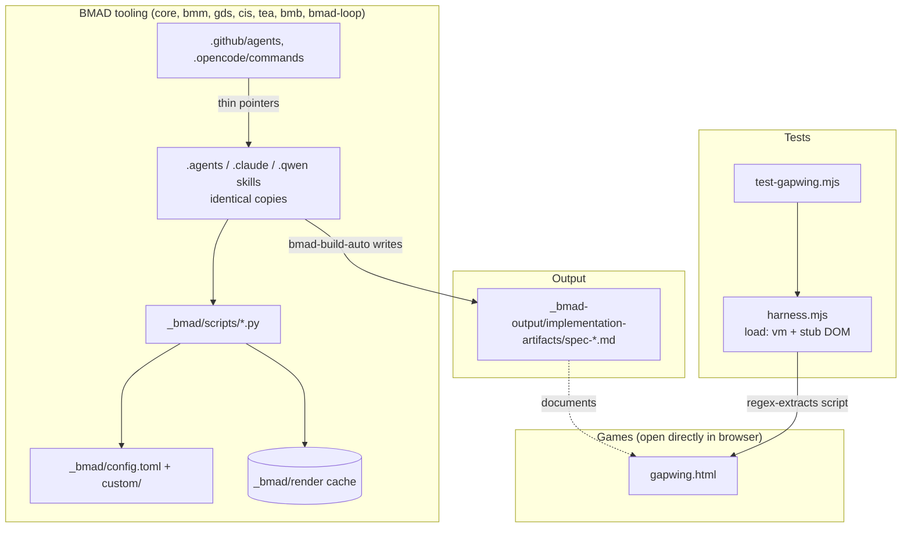
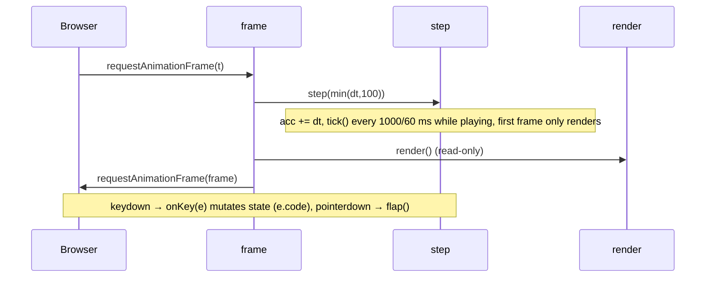
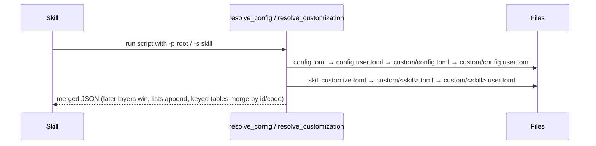

# Codebase Map

> Auto-generated by Cartographer. Last mapped: 2026-11-21T21:03:16Z

The totals count the 9 tracked project files. The vendored BMAD install (`_bmad/`, `.agents/`, `.claude/`, `.qwen/`, about 4,100 files and 10M tokens) is gitignored and not counted; only its structure is mapped here.

## System Overview

The project is one standalone browser game in a single HTML file, built on a testable pattern meant for more games. A shared Node harness drives it in `node:vm`, and a BMAD agent-framework install produced the specs. There is no build step and no package.json.



## Directory Structure

```
retro-games/
├── gapwing.html        # Gapwing: one-button flyer, fixed 60 Hz frames, step(dt)
├── harness.mjs         # load(file, globals): runs a game's <script> in node:vm with stub DOM
├── test-gapwing.mjs    # Gapwing self-check (`node test-gapwing.mjs`)
├── docs/               # Project knowledge (BMAD project_knowledge path). This map.
├── _bmad-output/
│   └── implementation-artifacts/
│       └── spec-gapwing-flappy-game.md # status: done, three review passes logged
├── _bmad/              # BMAD v6.12.4 install: core, bmm, gds 0.7.2, cis 0.3.2, tea 1.27.2, bmb 2.2.2, bmad-loop 0.13.2
│   ├── config.toml, config.user.toml   # installer-managed. Do not edit.
│   ├── custom/                         # SAFE to edit: team/personal overrides
│   ├── scripts/                        # config resolution, renderer, memlog
│   ├── render/                         # generated render cache (gitignored, empty now)
│   ├── _config/                        # installer manifests and help CSVs
│   └── bmm/, core/, gds/, cis/, tea/, bmb/, bmad-loop/  # per-module config.yaml + module-help.csv
├── .agents/skills/     # 90 skills (opencode target; .github agents point here)
├── .claude/skills/     # same 90 skills (claude-code target)
├── .qwen/skills/       # same 90 skills (qwen target)
├── .github/agents/     # 18 Copilot agent pointers -> .agents/skills
└── .opencode/commands/ # OpenCode command pointers (@skills/<name>)
```

## Module Guide

### gapwing.html

**Purpose**: Original one-button flyer on a 400×600 canvas: flap a circle bird through gaps between scrolling pillars. Art is canvas shapes only, with parallax hills, clouds and ground.
**Entry point**: open the file in a browser. The bottom of the script calls `reset()` and then starts `requestAnimationFrame(frame)`.

| Item | Detail |
|---|---|
| Constants | `W=400`, `H=600`, `GROUND=540`, `FRAME=1000/60`, `GRAVITY=0.5`, `FLAP_VY=-8`, `SPEED=2` (per frame), `BIRD_X=100`, `BIRD_R=12`, `START_Y=260`, `PIPE_W=60`, `SPAWN_EVERY=90` frames, `MARGIN=60`, `GAP0=150`, `GAP_MIN=100`, `RESTART_MS=500` |
| State | Top-level `let`s: `state` (`ready`/`playing`/`over`), `y`, `vy`, `pipes` (`{x,top,gap,scored}[]`), `score`, `acc`, `spawnT`, `overTime`, `dist` (px scrolled, drives parallax) |
| Logic | `reset()`, `gapFor(score)`, `spawnPipe()`, `hits(p)` (circle vs pillar column; the top pillar extends upward without limit), `die()`, `tick()` (one 60 Hz frame: move, cull, spawn, score, then death check), `step(dt)` (frame accumulator; stops after a death mid-step; only counts `overTime` while over), `flap()`, `onKey(e)` |
| Render | `render()` only reads state. `layer()` tiles a scrolled layer: far hills at `dist*0.2`, clouds and near hills at `dist*0.5`, ground ticks at `dist`. Score, ready title and hint, and game-over text are drawn on the canvas; the restart hint appears only after 500 ms. `setText()` updates `#status`. |
| Loop | `frame(t)`: `step(min(dt,100))` then `render()` |
| Input | Space keydown (`preventDefault` even on repeat; repeat does not flap) and `pointerdown` on `document` with `e.button === 0` (left click, touch, pen), both call `flap()`. Ready → playing on the first flap. Over: input is ignored for 500 ms, then `reset()` returns to ready. |
| Scoring | +1 when a pillar's right edge passes the bird's centre (checked before the death check, so the fatal tick can still score). Gap = `max(100, 150 - 5·floor(score/5))`, fixed per pillar at spawn. |
| Persistence | None (by spec) |
| A11y | Canvas has `role="img"` and an `aria-label`. `#status` is `aria-live="polite"` and changes only with the state. |
| Layout | Canvas `width="400" height="600"`, CSS `max-width:100%`, `max-height:80vh`. `body` uses `min-height:100vh` so short viewports scroll instead of clipping; `touch-action: manipulation`. |

### harness.mjs, test-gapwing.mjs

**harness.mjs** exports `load(file, globals = {})`. It:
- regex-extracts the single bare `<script>`;
- runs it in `node:vm` with a stub `document.getElementById` (which returns `{getContext, textContent}`), a captured `document.addEventListener` and a no-op `requestAnimationFrame`;
- uses a Proxy `ctx2d` that records `fillText` calls into `texts`. Extra globals, such as a `localStorage` stub, are passed through `globals`.

`load` returns:
- `run(code)`: evaluates code inside the vm. This is the only way to reach top-level `let`s.
- `key(code, repeat=false)`
- `listeners`
- `texts`

**test-gapwing.mjs** covers Gapwing:
- the still ready screen and its hint
- start and flap via Space and pointerdown, flap not additive, key repeat
- gravity and 60 Hz frame timing
- pillar spawn timing and gap range
- score once per pillar
- pillar, corner, over-the-top and ground hits
- the game-over screen, the 500 ms restart gate and reset
- the gap ramp and its floor, per-pillar gap kept after score changes
- cull timing, spawn bounds at both `Math.random` extremes
- death mid-step stops the frame loop, the 100 ms dt cap (5 or 6 ticks)
- pillars already behind the bird, open sky above the screen
- rAF bootstrap and re-queue, `render()` leaves state unchanged, canvas 400×600
- the `#status` text and one write per state change
- `preventDefault` scope, non-Space keys don't flap

It loads the game several times with different `globals`: a `Math` built with `Object.create(Math)` to pin `random` (spreading `Math` gives an empty object), a recording `requestAnimationFrame`, and a `document` whose elements persist per id and count `textContent` writes.

Run it with `node test-gapwing.mjs`. It uses only Node built-ins plus `node:assert/strict`.

### _bmad-output/implementation-artifacts

These are BMAD `bmad-build-auto` specs, one per game (only Gapwing's now). They are documentation only and nothing reads them at runtime. Each has a Spec Change Log; stale lines are marked superseded, not deleted.

### _bmad/scripts

| Script | Purpose | Usage |
|---|---|---|
| `config_utils.py` | Shared library: `load_toml`, `structural_merge`, `merge_layers`, `load_central_config`, `load_customization`, `ConfigError` | imported |
| `resolve_config.py` | Prints merged central config as JSON | `python3 _bmad/scripts/resolve_config.py -p <root> [-k core.output_folder]` |
| `resolve_customization.py` | Prints one skill's merged customization. `find_project_root` picks the nearest ancestor with `_bmad/`. | `... -s <skill dir> [-k workflow.persistent_facts]` |
| `render_skill.py` | Compiles `bmad-build` / `bmad-build-auto` markdown into an immutable, hash-verified snapshot under `_bmad/render/` | `uv run --no-cache _bmad/scripts/render_skill.py --project-root R --skill <dir>` |
| `memlog.py` | Append-only `.memlog.md` working log (`init`, `append`, `set`; atomic writes) | used by brainstorming, deep-recon and others |

These need Python 3.11+ (`tomllib`); `memlog.py` runs on 3.8+.

### Installed skills (vendored)

Each of `.agents/skills`, `.claude/skills` and `.qwen/skills` holds the same 90 skills, byte-identical across the three trees.
- `bmad-*` (39): core and bmm.
- `bmad-cis-*` (10): cis.
- `bmad-testarch-*` (8): tea.
- `gds-*` (33): game dev. The ones that matter here are `gds-quick-dev`, `gds-dev-story`, `gds-agent-game-dev`, `gds-agent-game-solo-dev`, `gds-gdd` and `gds-playtest-plan`.
- `bmb` (`bmad-agent-builder`, `bmad-module-builder`, `bmad-workflow-builder`, `bmad-bmb-setup`) and `bmad-loop` (`bmad-loop-*`): 8 skills.

The installer manages all 90 skills for the three tools in `manifest.yaml`: claude-code, opencode and qwen.

## Data Flow

### Game frame



### BMAD config resolution



## Conventions

- Each game is one self-contained `.html` with inline `<style>` and exactly one bare `<script>`. Vanilla JS, with no CDNs, modules or classes.
- **Game shape:**
  - Constants and state live in top-level `let`s.
  - `reset()` starts a game, and `step(dt)` owns all timing.
  - `render()` only reads state.
  - `onKey(e)` uses `e.code`, is registered with `document.addEventListener('keydown')`, and calls `preventDefault` only for game keys.
  - Pointer input, if any, also goes on `document` (the harness's stub elements have no `addEventListener`).
  - A `frame(t)` rAF loop caps dt at 100ms. The script ends with `reset(); requestAnimationFrame(frame);`.
- Canvas 2D draws the board. DOM HUD text goes through `setText()`, which skips unchanged values so `aria-live` doesn't re-announce them. Gapwing draws its score on the canvas and uses `setText()` only for `#status`.
- Each game gets a test file `test-<name>.mjs` that uses `load()` from `harness.mjs`.
- Specs go to `_bmad-output/implementation-artifacts/spec-<name>.md`. Record changes in a Spec Change Log rather than rewriting history.

## Gotchas

- **The script regex needs a bare `<script>`.** Adding attributes (`type="module"`, `defer`) breaks `harness.mjs`.
- **Top-level `let` is not on the vm global.** Use `run('expr')`. Arrays cross the vm realm boundary badly, so return `JSON.stringify(...)` and parse it.
- **Only the stubbed DOM surface works at load time:** `getElementById().getContext()`, `.textContent`, `addEventListener` and `requestAnimationFrame`. Anything else, such as `.style`, `window` or `setInterval`, needs a stub passed via `load(file, globals)`.
- **`listeners[type]` keeps only the last listener per event type**, and the default `getElementById` returns a fresh element on every call, so `setText` writes can't be observed without a custom `document` in `globals`. `globals` are spread after the defaults, so they replace `Math`, `document` or `requestAnimationFrame` wholesale.
- **Gapwing has no ceiling.** The bird can fly above the canvas; a pillar column there still kills it. Caps and beak are drawn outside the hitbox on purpose.
- **The skill trees are triplicated, not symlinked.** Hand edits drift, so customize through `_bmad/custom/<skill>.toml`. The installer rewrites all three on every update.
- **gds `primary_platform = "other"`** (web, set with `--set`). `gds-test-framework` still targets Unity, Unreal and Godot, not this harness.
- **Installer-managed, do not edit:** `_bmad/config*.toml`, `_bmad/*/config.yaml`, `_bmad/_config/*`, `*/module-help.csv`, and every skill's `customize.toml`.
- **Local fix in `_bmad/config.toml`:** `[modules.gds]` had `planning_artifacts`, `implementation_artifacts` and `project_knowledge` duplicating `[modules.bmm]`, which made `render_skill.py` halt with "ambiguous config value". They were removed (GDS skills read `_bmad/gds/config.yaml`). A reinstall brings them back.

## Navigation Guide

- **Add a new game:**
  1. Copy the shape of `gapwing.html`.
  2. Add `test-<name>.mjs` that calls `load('./<name>.html')`.
  3. Optionally add `_bmad-output/implementation-artifacts/spec-<name>.md`.
- **Change Gapwing physics, spawn or ramp:** the constants are at the top of `gapwing.html`; `tick()` runs one frame, `gapFor()` sets the ramp, `hits()` the hitbox. Then update `test-gapwing.mjs`.
- **Run the tests:** `node test-gapwing.mjs`. Nothing in the repo drives the games in a real browser.
- **Customize a BMAD agent or workflow:** use `_bmad/custom/<skill>.toml` (team) or `.user.toml` (personal). The `bmad-customize` skill helps with this.
- **Change BMAD output paths:** set `[core].output_folder` and `[modules.<mod>].*_artifacts` in `_bmad/custom/config.toml`.
- **Add or remove BMAD modules:** `npx bmad-method@6.12.4 install --directory . --modules bmm,gds,cis,tea,bmb,bmad-loop --tools claude-code,opencode,qwen --set gds.primary_platform=other --action update --yes`. Leaving a module out of `--modules` does not delete its skill directories; remove those by hand.
- **Inspect the merged BMAD config:** `python3 _bmad/scripts/resolve_config.py -p "$PWD"`.
